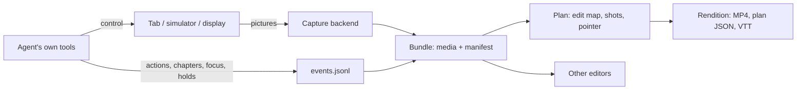

# Screen Studio: capture tool design

Status: built as `@deus/screen-studio` 0.2 in `packages/screen-studio`, used by Deus through its public entry. Updated 2026-11-07. The package stays in this repository until it is extracted; see [its README](../packages/screen-studio/README.md) for usage.

## Product boundary

Screen Studio records what an agent does and turns it into video. It records; it does not drive. The agent keeps its own tools — agent-browser, Playwright, device-use, agent-device, Cua. A browser tab reports its own input; other controllers report what they did, live or in a log imported afterwards. Two workflows share one capture:

- A coding agent records a short walkthrough, marks what matters, and gets an MP4 with readable pacing, framing and chapters.
- An editor (Showtell, a human, another agent) opens the original media and its events, and makes its own choices.

The **bundle** is the product: original media that any player opens, plus JSON that says where it came from, how its clock maps to the machine clock, and what happened while it recorded. A rendered video is one rendition of it, repeatable without recapturing.

## Architecture

| Layer     | Modules                                                 | Responsibility                                                                                                                   |
| --------- | ------------------------------------------------------- | -------------------------------------------------------------------------------------------------------------------------------- |
| Capture   | `capture/*`, `recorder.ts`, `daemon.ts`                 | Resolve a source, own its clock, enforce limits, finalize and verify media, recover a dead recorder's footage                    |
| Bundle    | `bundle/*`, `import.ts`, `adapters/*`                   | Versioned manifest and event schema (zod), atomic manifest writes, append-only events; agent-device and Cua logs as events       |
| Edit      | `edit/*`                                                | Timeline in media time and pixels, motion analysis, pacing, the edit map, chapter remapping                                      |
| Direction | `direct/*`                                              | Shot planning with reasons, spring camera, generated pointer and touch tracks, presets                                           |
| Render    | `render/*`                                              | Layout, painter, streaming decode → paint → encode, contact sheets                                                               |
| Surfaces  | `agent-tools.ts`, `cli/`, `mcp/`, `skills/`, `index.ts` | The agent tools any host registers; one JSON result per CLI command; MCP over the same tools; the agent skill; the SDK Deus uses |

**Process model.** The SDK owns a recorder in-process (Deus, the MCP server). The CLI cannot — it exits — so `start` creates the bundle, spawns a detached worker that owns the recorder, and returns once media is flowing. Events never pass through the worker: any process appends them to `events.jsonl`, and only the recorder writes the manifest. The worker's jobs are capture, deadline, and finalization, so it stays responsive to `stop`. It is registered as owner the moment it is spawned and handles signals before startup, so a stop during a slow start (resolving a source, waiting for a first frame) is clean. `stop` signals only a process whose command line is that bundle's worker — PIDs get reused, and an in-process owner (Deus, the MCP server) is never signalled from outside. Capture helpers live in the worker's process group, so a dead or timed-out worker's helpers are stopped as a group.

## Decisions and the evidence for them

**The recorder owns the clock.** A DevTools screencast sends frames only when the page changes (93 frames in 4 s during an animation, none while still; first frame 170 ms after start, frame timestamps within ~10 ms of receipt). The old recorder provoked frames with synthetic mouse moves; capture must not generate input. The frame pump re-emits the latest frame every tick, so frame _k_ is on screen at start + _k_/fps. Measured on a real take: 12 768 ms wall window, 12 800 ms media (one frame of quantization), 384 frames in 177 KB because still frames compress to almost nothing.

**Each backend reports how it knows media zero.** simctl prints "Recording started" after its first frame (uncertainty ~50 ms). For FFmpeg inputs, media zero is `now − out_time` at the first progress report — which was 1.3 s wrong until the encoder ran with `-tune zerolatency`: x264's lookahead delays output timestamps. After the fix: 6 929 ms window, 6 933 ms media.

**Stop authority is separate from automation.** The earlier experiment's provider-owned stop waited behind the automation queue. Our recorder stops on its own timer. FFmpeg also needed SIGINT instead of `q` on stdin, which it only polls between frames and which let ~2 s more media in.

**Crashes keep footage.** Capture writes fragmented MP4, playable up to its last fragment; `stop` on a bundle whose owner died stops orphaned helpers (simctl finalizes on SIGINT) and recovers the media with `stopReason: owner-lost`. Covered by a test that `SIGKILL`s the worker.

**Retiming keeps every frame.** Dividing timestamps that sit on the 1/fps clock rounded sped-up frames onto each other: 20 alternating 1×/6× segments rendered 271 frames instead of 275, up to 150 ms off the edit map. Retiming on a 1/90000 timebase makes the count exact; a test checks it.

**A recording either has verified media or reports failure.** The old CLI answered "done" with an empty path. `stop` now decodes every frame before marking a bundle complete; a failed start leaves a failed manifest with a code and hint.

**Pacing follows results, not gaps between commands.** Each action is kept from 0.7 s before it starts until 1.2 s after it completes. "No input" does not mean "nothing happening", so motion analysis separates still waits (6×) from moving ones (2×); a wait over its 2 s budget keeps a sped-up head and tail and cuts the middle. Motion uses `freezedetect` on a 256-px copy, so a spinner or caret reads as still — a spinner is not evidence that a result arrived. On the browser fixture, a 3.6 s generation wait played in 0.6 s; the whole take went from 12.8 s to 8.9 s with every action and result at real speed. The old planner could exceed its maximum rate and computed a lead trim it never applied; both are gone.

**One edit map.** FFmpeg retimes pixels from `EditMap.ffmpegFilter()`; camera, pointer, chapters and event times use `toOutput()`. Sparse media (simctl) is normalized to a constant rate and padded by holding its last frame — without that, a still ending rendered 2.3 s short of its plan (the render now checks itself against the plan and warns).

**The camera explains itself.** Nearby actions share a shot that fits all their targets; page-level actions stay wide; a `focus` hint overrides action framing while it lasts; shots that would never settle are dropped with a warning. In the earlier experiment, action-only framing showed 29% of a result panel and one semantic hint showed 100%; the agent-facing control is therefore "show this result", never coordinates or spring constants. Phones keep a static camera by default: zooming into a portrait screen inside a landscape frame cropped the UI sideways.

**The pointer is presentation.** It is generated between recorded targets and the plan says so. The default is the Cua driver cursor in black with a white outline (MIT, attributed in NOTICE); its hotspot is the apex of its rounded tip, not the path's first point. Pencil's cursor was not shipped: it came from a proprietary app bundle.

**Rendering is safe inside a host.** Uploading raw pixels with `putImageData` cost 25–30 ms of main-thread time per 1080p frame. Decoding JPEG with `loadImage` and rasterizing at `encode()` costs ~5.5 ms, with compression on libuv's pool. Skia's `high` smoothing was 9× slower than `medium` and indistinguishable at 2× pixel zoom. A 235-frame 1080p render went from 25 s to 2.4 s. Frames stream one at a time, so memory is flat; the old renderer decoded the whole recording into memory, synchronously.

**Browsers report their own actions.** The browser source watches the tab's trusted input with passive listeners, so any driver — agent-browser, Playwright, a person — yields exact targets with no integration. On Deus's own tool path, the earlier per-tool bridge saw 3 of 6 actions (a batch of two clicks became one "other" with no location; a key press and an outside click were missed) and stamped each action at tool start, ~210–230 ms before the real input, lasting the whole tool call including its snapshot. The observer saw all six at the real input. A render from bridge events alone never saw the click that started the generation, so it sped through the moment the result appeared. Deus's browser bridge is removed; simulator tools still report touches, since a simulator has no page to watch.

**Results are found in the picture.** Most recordings end an action with a wait and an answer somewhere else on screen (a generated preview, a confirmation). Motion analysis marks when the picture changed after a still stretch; a change 0.3–30 s after an action is kept at 1× and framed. Where it changed (8×8 tiles at 256 px, so carets and spinners don't count) is measured only for those results and cached, because measuring every change capped long recordings at 40. On the fixture this found the generated preview, 5.0 s after the click, without a focus hint — the 29%-coverage problem the direction experiment met with action-only framing.

**A frozen picture is detected at its source and cut.** A hidden tab, a hidden `<webview>` or a minimized window sends no frames (table below), so the recording holds the last picture — and in a long hidden stretch, the edit would only speed it up. The page observer watches its own animation frames: they stop when the page is not painted, while timers keep running at about one a second. A frame gap that at least two on-time timer ticks ran through is recorded as an `unseen` span from the last frame to the next one; a gap the timers could not run in is a busy main thread, which the picture shows truthfully and which keeps its actions. In Electron, recording a `<webview>` through the package while the host hid it, minimized the window, and stopped while it was hidden: the spans were 2620–5749, 8936–11908 and 11936–16408 ms, against frozen-picture ranges from `freezedetect` of 2633–5767, 8967–11933 and 11933–16433 (the last one is real: the restored window stayed occluded). Edited presets cut the spans and leave out the actions inside them — a click dispatched into the hidden tab — and the render warns; 16.4 s became 5.5 s with no frozen frame. `review` keeps original timing.

**A phone gets a portrait canvas.** On a 1920×1080 canvas a framed phone screen is about a third of the width; the preset canvas turns portrait for portrait sources unless a size is given. Source-size output keeps within a 1920 px long edge (a Retina display capture would otherwise render at 3456 px).

**Tabs can be shared.** An early probe suggested two screencasts on one tab starve each other; it was wrong (its page animated only briefly). Measured with continuous animation: one screencast alone 179 distinct frames in 3 s, two at once 180 and 180; agent-browser's viewer stream held 60 fps while a recording joined it or ran its own screencast. Joining an existing stream is still the default for agent-browser sessions that stream, because it saves the browser a second encode.

**Type checking was the declaration OOM.** `McpServer.registerTool`'s generic signature (zod 3 and 4) made the compiler run for minutes and the declaration build exhaust memory. Registering through an erased signature, with handler arguments typed by plain zod inference, brought the package check to ~9 s and the declaration build to 16 s.

## Deus integration

- `apps/agent-server/agents/deus-tools/recording.ts` imports the package's public entry (`packages/screen-studio/src/index`), the same API other hosts use.
- `recording_start` records the session's browser tab — the managed BrowserView in Electron, otherwise the tab agent-browser drives, found through `agent-browser get cdp-url` — or, with `target: "simulator"`, the session's simulator. The global `AGENT_BROWSER_STREAM_PORT=9223`, which every session shared, is gone.
- Browser actions come from the page observer, so browser tools report nothing. Simulator taps, swipes, typing and key presses are reported by the simulator tools with the points they acted on (`recordSimulatorAction`). Typed text is never read, only counted.
- The tools themselves come from the package's `createAgentTools`; Deus supplies the source, the bundle directory and element-ref lookup. New: `recording_focus` (by element ref) and `recording_hold`. `recording_stop` renders a preset and returns the shape the chat's recording card already renders, plus the render's warnings.

## Hosting it elsewhere (AGNT)

AGNT runs agent-browser inside an E2B sandbox; its sidecar keeps a 2 fps live viewer and a per-turn recorder on agent-browser's viewport stream. Emulated locally with agent-browser 0.39 and a viewer client connected throughout:

- An `agent-browser:<session>` source joins the session's stream (`stream status` gives the port) and watches the page over DevTools. The viewer held 60 fps before, during and after recording; recording with its own screencast instead also left it at 60 fps.
- A 55 s session with 20 s and 12 s thinking gaps: all four actions came from the page (type 1.1 s, clicks 3.1, 24.1, 42.1 s) and the result 5.0 s after "Generate" was framed. Review kept 55.0 s; walkthrough 15.4 s (9.5 s kept, 35.7 s sped, 9.9 s cut); demo 10.7 s.

So the sidecar would replace its recorder's internals with `startRecording({ source: agent-browser… })` per turn (or on request) and `renderBundle` on stop, register `createAgentTools` with its MCP layer, and keep its `browser.recording-completed` event (adding chapters and a bundle link). Its current recorder drops idle frames while capturing; this keeps the whole take and decides afterwards, so a turn can be re-cut or re-rendered.

## Desktop agents and iOS apps

Where there is no page to listen to, the controller is the source of actions; video, idle cutting and result detection work the same on any footage.

- **iOS via agent-device.** Its `record` exports the video (touch indicators already drawn in) and gesture telemetry in media milliseconds and iOS points. `screen-studio import VIDEO --agent-device-telemetry FILE` turns that into a bundle; a real 30.2 s Safari take rendered to 10.9 s (walkthrough) and 7.9 s (demo), without doubling the touch indicators. Local simulators can also record with `ios-simulator:<udid>` while device-use reports taps (Deus does this).
- **Desktop via Cua.** Cua's trajectory recording writes one folder per action (`action.json`: tool, arguments, start/end ms from the recording start; before/after screenshots), `session.json`, a cursor log, and main-display video in display points with the system cursor drawn. `screen-studio import --cua-trajectory DIR` builds a bundle from it: turns become actions with their times and Cua's own summary as label (typed text counted, not copied), refused turns are left out, and no pointer is generated over the real one. A real 33.4 s trajectory replayed in 5.3 s. Click points are relative to the window screenshot, so actions carry no place on the display. Two limits showed up on a real Mac: a background agent's window was on another Space, so the display video could not show it, and Cua refused background input there; and Cua's cursor log is the user's mouse, not the agent's. Filming a desktop agent needs a display that belongs to the agent — a VM or sandbox desktop — or per-window capture (a ScreenCaptureKit helper, not built).

## Deus: recording while the browser tab is hidden

Measured with an Electron window hosting a `<webview>` the way Deus does, counting screencast frames over 2.5 s of animation:

| State                                                                       | Frames |
| --------------------------------------------------------------------------- | ------ |
| Visible                                                                     | 233    |
| `visibility: hidden` (how Deus hides the inactive browser tab)              | 0      |
| `opacity: 0`, even with another panel drawn over it                         | 232    |
| Moved offscreen, or `display: none`                                         | 0      |
| Window minimized                                                            | 4      |
| Window minimized, `webContents.setBackgroundThrottling(false)` on the guest | 208    |

So a Deus recording freezes whenever the user is not looking at the browser tab, and when the window is minimized. The package now finds those stretches and cuts them (above), which keeps the video honest but loses what the agent did there. Keeping the tab painted needs Deus itself, scoped to an active recording: hide the inactive browser tab with `opacity: 0` (keep `pointer-events: none`) instead of `invisible`, and switch off background throttling on the guest's webContents. Electron's `incrementCapturerCount` is not available on `<webview>` guests. Both need a recording started/stopped signal from the backend to the renderer and main process. Not implemented yet.

## Not done yet

- Native window capture: a ScreenCaptureKit helper. The experiment's Swift prototype compiled, but macOS permission blocked recording. Display capture works through AVFoundation.
- Following a browser into a new tab; today a closed tab ends the recording with `source-lost`.
- Audio, Windows/Linux desktops, physical devices, Android.
- A Showtell bridge: import the media and translate chapters and selected actions into source-time notes. The bundle has what it needs.
- Places for Cua actions: the window's frame on screen at each turn would map its click points onto the display.
- Keeping Deus's hidden browser tab painted while recording (above).
- device-use's simbridge looks for SimulatorKit in `Developer/Library/PrivateFrameworks`; Xcode 27.1 ships it in `Contents/SharedFrameworks`, so simbridge taps fail with that Xcode (this affects Deus's simulator tools too). The iOS capture test here released UI steps from the host instead.
- Extraction: publish, then switch Deus's import to the package name.

The earlier exploratory scripts (`experiments/capture-lab`) imported the modules this rebuild replaced and are no longer in the tree; their findings are summarized above.
